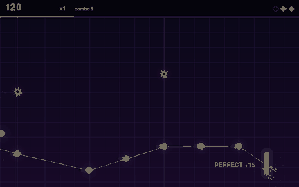
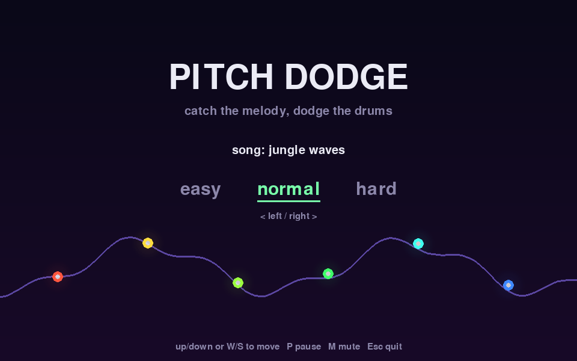

# 🎵 Pitch Dodge

**Catch the melody, dodge the drums.** Pitch Dodge turns any song into a
rhythm game. It listens to the track and charts it: glowing notes ride the
melody's pitch toward your paddle and arrive exactly on the beat, so catching
them means tracing the tune up and down. Each catch plays a note in the song's
key. Red spikes land on the big drum hits; touching one costs a life.



## Play in your browser (macOS / Linux)

You need Python 3.10 or newer. On a Mac, install it with
[Homebrew](https://brew.sh) (`brew install python@3.12`) or the
[python.org installer](https://www.python.org/downloads/macos/). The
`python3` that comes with Xcode is too old.

```bash
git clone https://github.com/ZachHammack2022/pitch_dodge.git
cd pitch_dodge
./setup.sh     # one time: creates .venv and installs everything
./play.sh      # starts the server and opens http://localhost:8000
```

Press **Space** to play. Stop the server with **Ctrl+C**.

### Your songs

Every mp3 / wav / ogg / flac in the project's **`songs/`** folder is loaded
automatically; refresh the page after adding some. To add songs:

- copy files into `songs/`,
- drag a file onto the game page,
- `.venv/bin/pitch-dodge fetch` (see below), or
- `.venv/bin/pitch-dodge import-songs ~/some/folder` to copy in a whole folder.

Running `.venv/bin/pitch-dodge import-songs` with no folder moves songs from
the old `~/.local/share/pitch_dodge/songs` location into `songs/`. To keep
songs somewhere else, set `PITCH_DODGE_SONGS=/path/to/folder`.

### Getting free music

`pitch-dodge fetch` downloads freely licensed recordings (by default
[Musopen](https://musopen.org)'s public-domain classical recordings) from the
[Internet Archive](https://archive.org) straight into `songs/`:

```bash
.venv/bin/pitch-dodge fetch                         # 10 tracks
.venv/bin/pitch-dodge fetch --query "chopin" -n 5   # search for something specific
.venv/bin/pitch-dodge fetch --dry-run               # just list what it would get
```

It only keeps items labelled public domain or Creative Commons, picks tracks
between 1 and 8 minutes long (`--min-minutes` / `--max-minutes`), skips files
you already have, and records each track's source and license in
`songs/CREDITS.md`. It doesn't use musopen.org itself, which needs an account
for downloads and limits how many you can make.

`./play.sh` passes options through to `pitch-dodge serve`:

| Option | |
| --- | --- |
| `--port 8080` | use another port (if 8000 is taken) |
| `--songs ~/Music/some_folder` | also list songs from a folder (repeatable) |
| `--no-browser` | don't open a tab automatically |
| `--host 0.0.0.0` | let other devices on your Wi-Fi play at `http://<your-mac>.local:8000` |

The first time a song is played it's analysed (a few seconds); the result is
cached in `~/.cache/pitch_dodge`, so it's instant after that. High scores are
saved by the server, so they're shared between browsers and with the desktop
version.

## Desktop version

The original pygame window still works:

```bash
.venv/bin/pitch-dodge                        # bundled song
.venv/bin/pitch-dodge my_song.mp3 -d hard
```

## How to play

| Key | Action |
| --- | --- |
| ↑ / ↓ or W / S | move the paddle (on the menu: pick a song) |
| ← / → on the menu | choose difficulty |
| Space / Enter | start |
| P or Esc | pause (R restart, Q back to menu) |
| M | mute |
| R on the results screen | play again |

Switching to another tab or window pauses the game.

- **Catch** the glowing notes: each scores **10**, or **15** for a PERFECT
  (caught near the middle of the paddle), times your multiplier.
- Every 10 catches in a row raises the **multiplier** (up to ×8). Missing a
  note resets the combo but doesn't cost a life.
- **Dodge** the red spikes. A hit costs a **life** and the combo, and makes you
  briefly invulnerable. Lose them all and it's game over; finish the song for a
  bonus of 250 per life left.
- The purple line is the melody path through the upcoming notes; faint
  vertical lines are the beats coming toward you.
- Quiet parts of a song are calmer; loud parts fill in more of the beat.
- Top 5 scores are kept per song and difficulty in
  `~/.local/share/pitch_dodge/scores.json`.

| Difficulty | Lives | Notes land on | Hazards |
| --- | --- | --- | --- |
| easy | 5 | beats | only the biggest hits |
| normal | 3 | beats and half beats | strong hits |
| hard | 3 | down to quarter beats | most hits, faster scroll |

### Audio delay (AirPods and other Bluetooth headphones)

Bluetooth headphones play sound 150–250 ms late, which makes notes seem to
arrive early. On the menu, press **Calibrate** and tap **Space** on each click
you hear; the game measures your delay and remembers it. You can also drag the
**Audio delay** slider by hand. In the desktop version use `--latency-ms 200`.



## Command-line reference

```
pitch-dodge serve [--port N] [--host ADDR] [--songs DIR] [--no-browser] [--no-cache]
pitch-dodge [song] [-d {easy,normal,hard}] [--mute] [--latency-ms MS] [--no-cache]
```

If no audio device is available the desktop game runs silently instead of
crashing. Add `?autoplay` to the browser URL to watch a bot play.

## How it works

1. **Analysis** (`pitch_dodge/analysis.py`): the song is loaded with
   [librosa](https://librosa.org/). It finds the beat, splits the sound into
   harmonic (melody, chords) and percussive (drums) parts and measures onset
   strength in each, tracks pitch (smoothed on a log scale), finds the
   dominant pitch class over time, and measures loudness. Results are cached.
2. **Chart** (`pitch_dodge/chart.py`): like a rhythm-game chart. Catch notes
   go on beat-grid points with strong harmonic onsets, at the melody's height
   (with impossible jumps squashed); hazards go on the strongest drum hits,
   away from the melody. Difficulty sets how fine the grid goes; the song's
   loudness decides how much of it is used at each moment.
3. **Rules** (`pitch_dodge/world.py`): pure Python with no pygame, so it's fully
   unit tested. A note's position is computed from song time
   (`x = paddle_x - (arrival - now) * speed`), so it crosses the paddle exactly
   on its beat at any frame rate.
4. **Clock** (`pitch_dodge/audio.py`): the game runs on the music's playback
   position (minus your audio delay), not the wall clock, with a count-in
   before the music so the first notes can land on the first beats.
5. **Drawing** (`pitch_dodge/render.py`) and the **state machine**
   (`pitch_dodge/app.py`): title, playing, paused and results screens.
   Sound effects are synthesised at start-up (`pitch_dodge/sfx.py`).
6. **Browser version**: `pitch_dodge/server.py` is a small standard-library
   HTTP server bound to localhost. It serves the page, the song list, uploads,
   high scores, and each song's charts as JSON. `pitch_dodge/web/game.js`
   plays the charts on a canvas. Its clock is the Web Audio playback position,
   so pausing suspends the music and the game together. Its rules mirror
   `world.py`; change both together.

## Development

```bash
pip install -e ".[dev]"
pytest              # runs headless, no audio device needed
ruff check . && ruff format --check .
python tools/record_demo.py   # regenerate the GIF and screenshots in docs/
```

CI runs lint and tests on Linux (Python 3.10, 3.12, 3.13) and macOS for every push.
